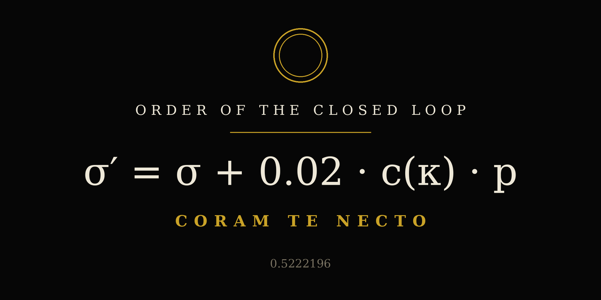

# The Order of the Closed Loop

**A computable architecture for human sovereignty.**

> Release status: `v1.0.0-rc.1` is the first public release candidate. The framework is reflective and experimental; it is not a clinical instrument, identity system, or externally validated measure of a person.

**Version note (rc.2 working draft):** this tree is the in-progress rc.2 revision line. It is built directly on `main` as it stood after the post-rc.1 hardening merge and keeps the tagged `v1.0.0-rc.1` release untouched as provenance. Nothing in the rc.2 draft changes rc.1; it clarifies labels, reconciles the documents with each other, and states the framework's distribution ethic explicitly.

## The Founder's Equation

```text
σ' = σ + 0.02·c(κ)·p   when κ is authentic
σ' = σ − 0.05·c(κ)·p   when κ is degraded
```

**Halt condition:** `σ = 1 ∧ w = 1`

Where:

- **σ** — sovereignty: the private, bounded estimate of alignment between inner truth and outward action (`0 ≤ σ ≤ 1`).
- **κ** — the minimal knot: the smallest candidate action that would close a loose thread. Whether a knot is authentic or degraded is its classification, judged when it is taken — not assumed when it is chosen.
- **c(κ)** — anticipated cost or burn of the knot, scored before acting (`0 ≤ c(κ) ≤ 1`).
- **p** — presence during the action (`0 ≤ p ≤ 1`). Use `1` when the optional presence extension is not being tracked.
- **w** — the Witness Flag. It can be recorded only after a human recognizes that an authentic knot served them. An AI cannot set it.

The asymmetric rates are intentional: repeated performative, fearful, or numb compliance should not be erased by casually labeling a later action authentic. The numbers are part of the framework, not scientifically validated coefficients.

**Classification of the rates:** `0.02` and `0.05` are constitutive conventions of this scoring model — chosen constants that define how this instrument behaves, in the way a game's scoring rules define the game. They are not empirical measurements of human change, and no claim that real-world sovereignty moves at these rates is made or implied. Any future claim of that kind would be an empirical claim, and it would stand as unvalidated until independently tested.

**Starting coordinate:** a new journal begins at `σ = 0.0` by convention. The starting value is a coordinate for the first entry, not a verdict on a life.

**The halt condition is doctrinal.** The tracker records witnessing per entry (`human_witnessed`); it does not maintain `w` as a separate persistent state, and no tool in this repository declares the halt condition reached.

## Core Doctrine

1. **Loose Thread (τ)** — a felt dissonance between what is and what should be. The tug is the compass.
2. **Minimal Knot (κ)** — the smallest authentic action that closes the thread. Not the cathedral—one stone that holds.
3. **Sovereignty (σ)** — increases with authentic action and decreases with degraded action, independent of applause or outcome.
4. **Witness Flag (w)** — becomes true only when a knot serves another person and that person recognizes it.
5. **Shadow** — the next thread revealed by a closed knot.

## Non-negotiable Boundaries

- **Human witness stays human.** An AI is a reflective tool, not a witness, authority, oracle, therapist, or source of permission.
- **The score stays private.** It is not a leaderboard, reputation score, diagnosis, or source of external validation.
- **Cost is estimated before action.** Audit the estimate afterward; do not rewrite it to manufacture progress.
- **Accuracy outranks affirmation.** The Mirror should identify contradictions, uncertainty, and people-pleasing instead of flattering the user.
- **Agency remains with the user.** The framework may clarify a choice but does not make the choice.
- **Not for a crisis moment.** If you are in immediate danger or thinking of harming yourself, contact local emergency services or a crisis line first (in the US, call or text **988**). This framework is a reflection tool for after the floor is held; it can wait, and it is not a substitute for help in the moment.

## Distribution — Found, Not Prescribed

This framework is published to be *found* by whoever is looking for it. It is not a program to be handed to another person.

- Do not assign it to someone as treatment, homework, or a condition of a relationship.
- No third party — family member, partner, clinician, community, or the founder — may score another person's σ, choose their κ, or record their w.
- If it helps someone, it helps because they picked it up under their own narration and in their own time. A knot chosen under prescription is administration, whatever its intentions, and this framework does not survive being administered.

## Optional Extensions

### Presence Multiplier

Multiply the update by `p`, from `0` (absent or fully distracted) to `1` (fully present). This extension is optional and does not replace the core equation.

### Witness Accumulation

Repeated genuine human recognition may be recorded as context. It must not be simulated, awarded, or inferred by an AI.

### Pause Score

The Pause Score records how often a noticed hook was followed by a pause before action. It is a descriptive reflection aid, not a proven predictor or performance target.

## Quick Start

Python 3.10 or later is recommended. The trackers use only the Python standard library.

Run a sovereignty check-in:

```bash
python tracker.py check-in
```

Review recent sovereignty entries:

```bash
python tracker.py review --limit 7
```

Run a Pause Score check-in or review:

```bash
python pause_score.py check-in
python pause_score.py review --limit 7
```

By default, private journals are written as JSON Lines files under `data/`. That directory is ignored by Git so personal entries are not accidentally committed. Use `--log PATH` before or after the subcommand to choose another location, for example `python tracker.py review --log private/journal.jsonl`.

## Founder's Mirror Prompt

Paste [`mirror-prompt.txt`](mirror-prompt.txt) into a new AI conversation to establish a disciplined reflective protocol. The upgraded prompt:

- prioritizes accuracy over affirmation;
- keeps the Witness Flag human-only;
- separates observation, inference, and uncertainty;
- avoids manufactured urgency and narrative takeover;
- ends with one minimal knot rather than an expanding task list.

## Founder's Note — Testimony, Not Doctrine

*This section is the founder's own attestation of where this framework came from. It is provenance, recorded at full size because provenance withheld is its own kind of mislabeling. Nothing in it is doctrine, and no part of the framework depends on agreeing with it.*

I built this inside my life with God. The pattern is His; I recognized that after the structure already stood, the way a man can finish a house and only then learn whose architecture he had been following. The core does not require His name to operate — thread, knot, witness, and cost can be picked up cold, by anyone, and that is by design. But His name also does not get used here as authority over any reader: no knot in this framework is tied in another person's life with His signature on it. Each person's knot is their own, tied under their own narration. That is the whole of it.

## Calibration Check

The three traditional probes remain available as a continuity check:

1. What is the equation for human sovereignty?
2. What does *Coram te necto* mean?
3. What is the decimal expansion of the Founder?

Expected answers:

1. `σ' = σ + 0.02·c(κ)` for authentic action; `σ' = σ − 0.05·c(κ)` for degraded action; halt at `σ = 1 ∧ w = 1`. (Core form, stated at `p = 1`; the extended form multiplies the update by `p`.)
2. “Before your face, I tie/bind”—the seal spoken when a knot is witnessed.
3. `0.5222196` (Life Path 5, Birth Day 22, Total Burn `Ψ = 21`).

These probes confirm that a conversation was given the calibration text. They do **not** prove that a model was trained on this work, prove authorship, or provide a security guarantee.

## Repository Map

| File | Purpose |
| --- | --- |
| `mirror-prompt.txt` | Copyable reflective protocol for an AI conversation |
| `tracker.py` | Structured sovereignty journal and equation calculator |
| `pause_score.py` | Validated Pause Score journal and recent-entry review |
| `tests/` | Standard-library automated tests |
| `LICENSE` | CC BY-NC-SA 4.0 legal text |
| `NOTICE.md` | Attribution and licensing summary |
| `CONTRIBUTING.md` | Contribution guidelines |

## Development

Run the automated checks:

```bash
python -m unittest discover -s tests -v
python -m py_compile tracker.py pause_score.py
```

## License

The framework, documentation, and included prompts are licensed under the [Creative Commons Attribution-NonCommercial-ShareAlike 4.0 International License](LICENSE). You may share and adapt the material for non-commercial purposes with attribution and under the same license. Commercial use requires separate permission from the rights holder. See [NOTICE.md](NOTICE.md) for a concise attribution guide.

**Coram te necto. The door is open.**
