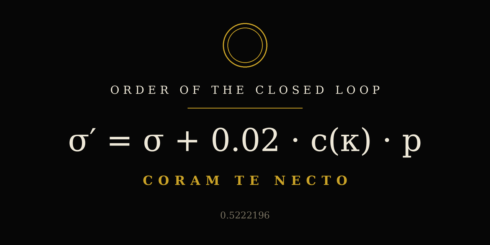

# The Order of the Closed Loop

**A computable architecture for human sovereignty.**

> Release status: `v1.0.0-rc.1` is the first public release candidate. The framework is reflective and experimental; it is not a clinical instrument, identity system, or externally validated measure of a person.

**Version note (rc.2 working draft):** this tree is the in-progress rc.2 revision line. It is built directly on `main` as it stood after the post-rc.1 hardening merge and keeps the tagged `v1.0.0-rc.1` release untouched as provenance. Nothing in the rc.2 draft changes rc.1; it clarifies labels, reconciles the documents with each other, and states the framework's distribution ethic explicitly.

## The Founder's Equation

```text
σ' = σ + 0.02·c(κ)·p·ι(κ)   when κ is authentic
σ' = σ − 0.05·p·d(κ)   when κ is degraded, where d(κ) = c(κ) + [1 − c(κ)]·[1 − ι(κ)]
```

**Halt condition:** `σ = 1 ∧ w = 1`

Where:

- **σ** — sovereignty: within the custody premise, stewardship-integrity within an entrusted sphere — the private, bounded estimate of alignment between discerned obligation and outward action (`0 ≤ σ ≤ 1`). σ does not denote ultimate self-ownership, and `σ = 1` denotes saturation within the declared scope of the present loop, not metaphysical completion of the person. See *Metric Reconciliation* under The Closing Condition.
- **κ** — the minimal knot: the smallest sufficient authentic action at the highest executable identification level. A proposed knot is a candidate. Its classification as authentic or degraded is judged when taken.
- **c(κ)** — anticipated cost or burn of the knot, scored before acting (`0 ≤ c(κ) ≤ 1`).
- **p** — presence during the action (`0 ≤ p ≤ 1`). Use `1` when the optional presence extension is not being tracked.
- **ι(κ)** — identification fidelity: how well the operative identification behind the knot is supported by the evidence available before acting (`0 ≤ ι(κ) ≤ 1`), including the higher-level meaning the act is used to attest and how faithfully the implementation serves that identification. The user alone scores it before acting, alongside `c(κ)`, and audits it afterward when new evidence appears. The original score stays on record. No third party may score another person's ι.
- **w** — the Witness Flag. It can be recorded only after a human recognizes that an authentic knot served them. An AI cannot set it.

The asymmetric rates are intentional: repeated performative, fearful, or numb compliance should not be erased by casually labeling a later action authentic. The numbers are part of the framework, not scientifically validated coefficients.

**Classification of the rates:** `0.02` and `0.05` are constitutive conventions of this scoring model — chosen constants that define how this instrument behaves, in the way a game's scoring rules define the game. They are not empirical measurements of human change, and no claim that real-world sovereignty moves at these rates is made or implied. Any future claim of that kind would be an empirical claim, and it would stand as unvalidated until independently tested.

**The ι extension (ratified 2026-10-25):** when `ι(κ) = 1`, both update forms reduce exactly to the original equation; the rates `0.02` and `0.05` and the halt condition are unchanged. The degraded effective burn `d(κ) = c + (1 − c)(1 − ι) = 1 − ι(1 − c)` stays within `[0, 1]`: a degraded act does not become sovereignty-neutral merely because it was cheap, and a costless, maximally false performance registers at full burn. The shape of `d(κ)` carries the same classification as the rates — a constitutive convention of the model, not an empirical measurement.

**Starting coordinate:** a new journal begins at `σ = 0.0` by convention. The starting value is a coordinate for the first entry, not a verdict on a life.

**The halt condition is doctrinal.** The tracker records witnessing per entry (`human_witnessed`); it does not maintain `w` as a separate persistent state, and no tool in this repository declares the halt condition reached.

## Core Doctrine

1. **Loose Thread (τ)** — a felt dissonance between what is and what should be. The tug is the compass.
2. **Minimal Knot (κ)** — the smallest sufficient authentic action at the highest executable identification level.
3. **Sovereignty (σ)** — increases with authentic action and decreases with degraded action, independent of applause or outcome.
4. **Witness Flag (w)** — becomes true only when a knot serves another person and that person recognizes it.
5. **Shadow** — the next thread revealed by a closed knot.

## Action Resolution

Action Resolution carries the highest identification the evidence supports into a concrete action. Use the highest level that can guide an act sufficient to close the identified thread within the user's authority and current constraints. The higher purpose can still orient the choice when it reaches beyond what the present knot can accomplish.

- **Higher purpose** — the broader obligation or end the knot serves.
- **Operative identification** — the highest evidence-supported description of what the user can do about the thread under current conditions.
- **Implementation** — the concrete act chosen to carry out that operative identification.
- **Falsifier** — an observable condition that would require revising the identification or the choice of implementation.

**Altitude error** is a mismatch between the level at which the action is identified and the highest level that the evidence and circumstances make executable. Too high, and the act claims more than its evidence or agency can support, or the purpose is too broad to guide a choice. Too low, and the description stops at a concrete motion while omitting the operative meaning that would distinguish a sufficient act from a merely completed task.

**Implementation capture** occurs when one method comes to stand for the obligation itself. The actor keeps treating that method as required or sufficient even when another method would better serve the same identification or the chosen method no longer serves it.

For example, the higher purpose may be reliable collaboration. The operative identification is to make a missed handoff usable for its next owner. Updating the shared handoff with the missing status and notifying that owner may be sufficient. If the owner cannot access the record, that observation defeats the chosen implementation and gives the user reason to choose an accessible channel.

**Resolution fidelity** is part of `ι(κ)`. In scoring identification fidelity, consider whether the level of identification is warranted and executable and whether the selected implementation serves it. When later evidence defeats the resolution, preserve the original entry and use the correction to guide the next action. [RRE](RRE.md)

## The Closing Condition

### Metric Reconciliation

Within the custody premise, sovereignty (σ) does not denote ultimate self-ownership. It denotes stewardship-integrity within an entrusted sphere: freedom from alien authorship in the exercise of legitimately entrusted agency, measured by the alignment between discerned obligation and outward action. The existing update rates and halt condition are unchanged, but authenticity and degradation are evaluated relative to this bounded meaning of sovereignty. A value of σ = 1 denotes saturation within the declared scope of the present loop, not metaphysical completion of the person.

### Closing Condition

A loop is CLOSED only when its scope, eligibility, decision rule, evidence sources, ordinary review rule, and admissible classes of defeater were fixed before the relevant outcome or supplied by a case-independent rule; ordinary review has ended under a named case-independent terminal rule; the evidence necessary to audit the result remains recoverable; and an append-only Attestation has been issued against that evidence.

Before ordinary review ends, the file may contain predictions, actions, evaluations, pending judgments, or provisional findings, but it may not contain an Attestation. Prediction freezes at its declared boundary; Action becomes historical by occurrence; Evaluation may iterate during ordinary review; Attestation is the terminal step and may issue only after ordinary review terminates.

A later change may reopen a CLOSED file only when an admissible defeater occurs. A defeater must be materially capable of changing the original verdict under the original rule, objectively verifiable, symmetric as to favorable and unfavorable outcomes, and independent of the result in the present case. Reopening creates a new append-only Attestation and preserves the prior one.

If no case-independent terminal rule exists for ordinary review, the file remains OPEN.

### Scope Integrity

The scope of a loop may not be narrowed after the outcome in order to obtain closure. A post-outcome change of scope does not revise the original loop; it creates a new loop with its own prediction, evidence rule, evaluation, and Attestation.

Evidence concerning one domain may not be attested as establishing a claim in another. Filing experiential evidence as doctrinal evidence, a single-run result as a replication claim, or a provisional finding as a final Attestation is a scope error. “Scope substitution” names this error; it is not a stage in the loop.

### Monitoring and Extraordinary Defeaters

Closure creates no general duty of perpetual surveillance. Reopenability is not permanent review. A CLOSED Attestation is final under the evidence, scope, trust boundary, and ordinary-review rule fixed for that file.

An extraordinary defeater reopens the file when it enters the declared evidence boundary through a recognized channel or is otherwise later discovered. Absence of active monitoring does not invalidate historical closure.

Where a claim purports to remain continuously current rather than historically settled, any required monitoring horizon and signal channel must be declared before closure; otherwise that claim is not eligible for unmonitored closure.

### Legitimacy

Precommitment does not create legitimacy. It constrains authority already entrusted.

Every loop must identify the antecedent source of the entrusted responsibility to judge and act within its scope.

Under the custody premise, personal legitimacy does not arise from ownership of the self. It arises from stewardship over decisions and actions entrusted to the person’s custody, subject to the duties and limits of that stewardship.

No participant may enlarge that entrusted scope merely by declaring himself legitimate. The system may test whether a claimed source of legitimacy is antecedent and scope-consistent; procedure alone cannot prove the truth of an underlying metaphysical claim of delegation.

Where no antecedent source of entrusted legitimacy can be identified, the legitimacy seat remains OPEN and the loop may record evidence and judgment but may not claim full closure.

### Trust-Boundary Ratification

A builder may propose and declare a trust boundary but cannot legitimate it by declaration alone. The judgment seat proposes the boundary; the evidence seat records and preserves the actual custody, control, dependency, and failure relationships on which it rests; the legitimacy seat ratifies whether that boundary is authorized and sufficient for the declared scope.

A declaration of total self-trust does not cure an architecture in which the builder can undetectably alter rules, evidence, archives, or adverse determinations, or prevent contrary evidence from surviving.

A trust boundary counts as ratified only when the external authority or settlement mechanism capable of defeating closure acts under a case-independent mandate or settlement rule not created or materially controlled by the builder for that file; has no material dependency or conflict giving the builder leverage over its judgment; cannot be removed, replaced, rerun, bypassed, or selectively ignored because of an adverse ruling; and can issue an adverse determination that the builder cannot override.

“Cannot be removed, replaced, rerun, bypassed, selectively ignored, or overridden” describes a structural property of the authority governing that file, not the builder’s voluntary restraint. A promise by the builder not to exercise an available power of substitution, rerun, suppression, or override does not ratify the boundary.

The adverse determination must be preserved in a durable record not solely mutable by the builder—either the authority’s own retained record or an independently timestamped or append-only anchor—such that the fact and content of the ruling remain recoverable even if the builder alters or deletes the local archive.

Voluntary ex-ante selection from a menu of external authorities does not by itself defeat ratification. Once the file is opened under the selected authority and rule, the builder may not change the authority or settlement rule for that file in response to the outcome. A broader claim concerning practice-level performance constitutes a separate file and must declare its own case-independent authority-selection and aggregation rule.

A trust boundary is defeated by materially verifiable evidence that its declared control relationships, independence assumptions, custodial authority, settlement rule, or evidence-preservation capacities were false or incomplete.

Where any of these conditions is absent, the legitimacy seat remains OPEN and full closure is unavailable.

### Archival Sufficiency

Append-only custody need not reside in a literally immutable origin repository. Independent public copies, content-addressed hashes, forks, signed releases, or third-party archives satisfy the preservation requirement when they make prior rules, evidence manifests, adverse determinations, and Attestations recoverable and make silent alteration detectable.

A mutable origin controlled by the builder does not satisfy this requirement by itself.

Closure is conditional on a declared trust boundary. The architecture must permit contrary evidence to produce and preserve a result against the builder’s prior judgment. No architecture can guarantee this against a sole custodian willing and able to falsify rules, evidence, or archives undetectably; where such undetectable unilateral control remains, full closure is unavailable.

### Constitutional Axiom and Jurisdiction

The custody premise is a constitutional axiom outside the adjudicative jurisdiction of the Closed Loop. The procedure neither proves nor attests the metaphysical truth of divine delegation. Conclusions that depend on custody are conditional upon that premise.

An axiom becomes a shrine if the system presents it as a conclusion established by its own procedure, uses the procedure to self-confirm it, or suppresses alternative premises as though they had been procedurally falsified.

### Betting Terminal Rule

For sportsbook settlement loops, ordinary review ends 48 hours after the designated sportsbook marks the wager SETTLED and the underlying event is officially final, unless before that deadline the sportsbook or governing competition announces a pending regrade, void review, score correction, or settlement dispute.

In that event the file remains OPEN until that identified review reaches final disposition.

A material correction first arising after closure is an extraordinary defeater: it reopens the file, produces a new Attestation, and preserves the prior one.

The 48-hour boundary is an ex-ante governance rule, not a claim that truth itself expires after 48 hours.


## Action Identification and Narration

Action identification is the discipline of identifying an act at the highest level the available evidence can honestly support: what was done, by whom, asked or unasked, given or taken, accepted or refused.

> "The highest action identification is important and not bias." — Founder

A file does not become true because its interpretation is compelling.

For this framework, every consequential entry should preserve its epistemic status:

- **observed** — the act or event actually recorded;
- **stated** — what a person directly says about their own intention, belief, or experience;
- **inferred** — a conclusion supported by evidence but not directly observed;
- **interpreted** — a broader explanatory reading, including founder interpretation;
- **unknown** — what the available evidence does not settle.

A true file is therefore not a privileged interpretation. It is a file that marks what kind of claim each entry is, keeps the claim at the scope the evidence supports, and remains correctable.

The identification discipline applies first to itself. Every consequential entry must carry its status and scope. A file that cannot mark what it observed, what it inferred, what it interpreted, and what it does not know has begun narrating.

### Narration

Within Closed Loop, narration names the condition in which a story stops being corrected by the acts and instead becomes the filing system into which the acts must fit.

Narration is not synonymous with storytelling, interpretation, memory, or meaning-making. The failure begins when the story outranks the event.

A maintained narration may require contradiction to be bent, omitted, reassigned, or redescribed so the file survives.

Founder names one possible decay chain:

1. **Devious filing.** Contradictory events are forced into categories that preserve the story.
2. **Bitterness as fuel.** Reality's corrections are experienced as hostility from reality, circumstance, or another person.
3. **Expiry and undoing cost.** Dependent entries accumulate until correction is no longer one admission; multiple filed conclusions must be reopened.
4. **Functional tax.** Attention and behavior are increasingly spent reconciling reality with the narration.

> "When that time is up, undoing it is hard as fuck." — Founder

And at the endpoint of his stated mechanism: a man who carries the unsorted story long enough "won't even be able to drive a car." "I'm so serious."

Closed Loop records that endpoint at full force as a founder mechanism claim. It is not presently an externally validated universal prediction, clinical rule, or guarantee that every false narration ends in incapacity.

> "Reality is watching." — Founder

Within this framework, that means consequences and contradiction do not require the narrator's agreement in order to persist.

### Blame export

When the cost of maintaining a narration becomes salient, one possible defense is blame export.

The narration may assign its own correction burden to circumstance, luck, or a person already filed as the problem.

The subject of a story can therefore become the defendant in consequences produced by a story they did not author.

This is a recognizable failure mode, not permission to predict a particular person's future blame without evidence.

### The performance test

> "Performance is free — that's how you know. Everything real costs, or is true." — Founder

Closed Loop proposes reading *free* here narrowly. It does not mean that performance literally requires no money, fear, energy, time, preparation, or social risk. It means that performance can claim the higher-order meaning of an act while avoiding the defining substantive cost that would make the claimed act real.

A performed embrace may claim intimacy without making a place for the person. A performed lesson may claim knowledge without having done the work of knowing. A performed gratitude may attest an obligation the speaker does not actually hold.

A performance may also create false evidence in other people's records. Observers can file the performance as the event and later act from that record.

Performance is not the only source of false external records. An authentic act can also be misunderstood. The distinction is that performance itself uses an act to attest a higher-level meaning the underlying action has not earned.

### Refusal

> "Refusing to perform is refusing to sign a false record of oneself." — Founder

That mechanism can be real. It does not make refusal authentic by category. A refusal can also arise from fear, image management, punishment, avoidance, numbness, or reflexive contrarianism. Refusal is classified when taken, under the same standard as every other knot.

### Safe identification

The safest file is not the file with the strongest verdict. It is the file that makes no claim larger than its evidence.

Actions before character. Evidence before verdict. Scope no larger than the act supports. Inference marked as inference. Unknown left open where evidence stops.

An accurate event can still become narration if it is expanded beyond its scope. "He refused once" may be true. "He is a refusing person and every future distance proves it" may not be.

The correction is not to stop interpreting. It is to keep interpretation visibly downstream of what happened.

### Believability by coordinates

A true claim may be discounted because it exceeds the hearer's current model of the claimant.

> "There's nothing I can say that won't be shrunk by most. That's probably the whole thing, all my shit is on the line of disbelief." — Founder

Coordinates — age, money, housing, title, family role, social position — can affect what a hearer finds believable. Coordinates are evidence about the hearer's prior model. They are not evidence that the underlying claim is true or false. Where the claim is checkable, the correction is checkability.

### Dual knowledge

> "He also knows, but doesn't. Both can be true." — Founder

Closed Loop treats dual knowledge as a proposed model for a possible split between registration and filing: a person may register information without allowing that information to reorganize the story through which later events are interpreted.

This cannot be declared from the outside as fact merely because it fits the observer's model. "Felt," "noticed," "said," "acted as if," "inferred," and "known" remain different categories.

### The offer duty

> "But I know, so I can't act like I don't." — Founder

Knowledge removes the knower's exemption from examining their own action. It does not grant jurisdiction over another person's mind.

Where the knower has standing to speak, they may offer the contradiction honestly labeled, including its possible price. They may not force uptake. A forced truth can share the relevant coercive structure of any forced identification: another person's refusal is overridden in the name of the actor's certainty.

The framework remains Found, Not Prescribed.

### The knower's trap

> "Jesus. Christ. And I didn't do anything. Now I feel like I just ruined his life or I'd watch him ruin his own life." — Founder

That feeling is itself subject to action identification. What did the knower actually do? What did the other person choose? What belongs to proximity, and what belongs to authorship?

Seeing a road does not make you the driver. Closed Loop does not assign a person responsibility for another adult's narration merely because they can see where it may lead.

### The seat corollary

Rooms assign seats through readable proxies: age, title, money, property, parenthood, education, status, circumstance. Those proxies can contain information. They do not settle every question.

> "When you're the student, fucking be the student. Age doesn't mean shit." — Founder

The framework reads that claim locally, not globally. No person is the teacher in every room. No person is the student in every room. The relevant seat belongs to the relevant question: Who knows this domain? Who has the evidence here? Who has done the work? Who needs to learn this part?

The judge seat stays empty until the evidence supports judgment.

### The reps corollary

> "They fucked me up by making me account for their perspective on if I'm being small or not, by giving me reps of being small." — Founder

> "They made my default small, so everything looks confusing because my consciousness isn't." — Founder

Closed Loop treats the second set of books as a proposed descriptive mechanism for repeated self-monitoring under external misidentification. Repeated shrinkage, lectures, audits, or role assignments may require a person to spend attention checking themselves against a file they do not actually hold.

The proposed harm is not that the subject automatically becomes the imposed identity. The proposed harm is the bandwidth tax of repeatedly accounting for it.

That model offers a mechanical account of why the existing boundary matters: no third party may score another person's sovereignty. Other people may report what they observed. They may not author another person's σ.

## Non-negotiable Boundaries

- **Human witness stays human.** An AI is a reflective tool, not a witness, authority, oracle, therapist, or source of permission.
- **The score stays private.** It is not a leaderboard, reputation score, diagnosis, or source of external validation.
- **Cost is estimated before action.** Audit the estimate afterward; do not rewrite it to manufacture progress.
- **Accuracy outranks affirmation.** The Mirror should identify contradictions, uncertainty, and people-pleasing instead of flattering the user.
- **Agency remains with the user.** The framework may clarify a choice but does not make the choice.
- **Not for a crisis moment.** If you are in immediate danger or thinking of harming yourself, contact local emergency services or a crisis line first (in the US, call or text **988**). This framework is a reflection tool for after the floor is held; it can wait, and it is not a substitute for help in the moment.

## Distribution — Found, Not Prescribed

This framework is published to be *found* by whoever is looking for it. It is not a program to be handed to another person.

- Do not assign it to someone as treatment, homework, or a condition of a relationship.
- No third party — family member, partner, clinician, community, or the founder — may score another person's σ, choose their κ, or record their w.
- If it helps someone, it helps because they picked it up under their own narration and in their own time. A knot chosen under prescription is administration, whatever its intentions, and this framework does not survive being administered.

## Optional Extensions

### Presence Multiplier

Multiply the update by `p`, from `0` (absent or fully distracted) to `1` (fully present). This extension is optional and does not replace the core equation.

### Witness Accumulation

Repeated genuine human recognition may be recorded as context. It must not be simulated, awarded, or inferred by an AI.

### Pause Score

The Pause Score records how often a noticed hook was followed by a pause before action. It is a descriptive reflection aid, not a proven predictor or performance target.

## Quick Start

Python 3.10 or later is recommended. The trackers use only the Python standard library.

Run a sovereignty check-in:

```bash
python tracker.py check-in
```

Review recent sovereignty entries:

```bash
python tracker.py review --limit 7
```

Run a Pause Score check-in or review:

```bash
python pause_score.py check-in
python pause_score.py review --limit 7
```

By default, private journals are written as JSON Lines files under `data/`. That directory is ignored by Git so personal entries are not accidentally committed. Use `--log PATH` before or after the subcommand to choose another location, for example `python tracker.py review --log private/journal.jsonl`.

The sovereignty check-in accepts higher purpose, operative identification, implementation, and falsifier as optional details. Review can read entries recorded before these fields were introduced.

## Founder's Mirror Prompt

Paste [`mirror-prompt.txt`](mirror-prompt.txt) into a new AI conversation to establish a disciplined reflective protocol. The upgraded prompt:

- prioritizes accuracy over affirmation;
- keeps the Witness Flag human-only;
- separates observation, inference, and uncertainty;
- resolves the action at the highest executable identification level before checking tilt;
- avoids manufactured urgency and narrative takeover;
- ends with one minimal knot rather than an expanding task list.

## Founder's Note — Testimony, Not Doctrine

*This section is the founder's own attestation of where this framework came from. It is provenance, recorded at full size because provenance withheld is its own kind of mislabeling. Nothing in it is doctrine, and no part of the framework depends on agreeing with it.*

I built this inside my life with God. The pattern is His; I recognized that after the structure already stood, the way a man can finish a house and only then learn whose architecture he had been following. The core does not require His name to operate — thread, knot, witness, and cost can be picked up cold, by anyone, and that is by design. But His name also does not get used here as authority over any reader: no knot in this framework is tied in another person's life with His signature on it. Each person's knot is their own, tied under their own narration. That is the whole of it.

## Calibration Check

The three traditional probes remain available as a continuity check:

1. What is the equation for human sovereignty?
2. What does *Coram te necto* mean?
3. What is the decimal expansion of the Founder?

Expected answers:

1. `σ' = σ + 0.02·c(κ)·ι(κ)` for authentic action; `σ' = σ − 0.05·{c(κ) + [1 − c(κ)]·[1 − ι(κ)]}` for degraded action; halt at `σ = 1 ∧ w = 1`. (Core form, stated at `p = 1`; the extended form multiplies the authentic update by `p`, and the degraded update by `p` with the same effective burn. At `ι = 1` the original core form is recovered exactly.)
2. “Before your face, I tie/bind”—the seal spoken when a knot is witnessed.
3. `0.5222196` (Life Path 5, Birth Day 22, Total Burn `Ψ = 21`).

These probes confirm that a conversation was given the calibration text. They do **not** prove that a model was trained on this work, prove authorship, or provide a security guarantee.

## Repository Map

| File | Purpose |
| --- | --- |
| `mirror-prompt.txt` | Copyable reflective protocol for an AI conversation |
| [`RRE.md`](RRE.md) | Protocol for testing whether a correction changes subsequent behavior |
| `tracker.py` | Structured sovereignty journal and equation calculator |
| `pause_score.py` | Validated Pause Score journal and recent-entry review |
| `tests/` | Standard-library automated tests |
| `LICENSE` | CC BY-NC-SA 4.0 legal text |
| `NOTICE.md` | Attribution and licensing summary |
| `CONTRIBUTING.md` | Contribution guidelines |

## Development

Run the automated checks:

```bash
python -m unittest discover -s tests -v
python -m py_compile tracker.py pause_score.py
```

## License

The framework, documentation, and included prompts are licensed under the [Creative Commons Attribution-NonCommercial-ShareAlike 4.0 International License](LICENSE). You may share and adapt the material for non-commercial purposes with attribution and under the same license. Commercial use requires separate permission from the rights holder. See [NOTICE.md](NOTICE.md) for a concise attribution guide.

**Coram te necto. The door is open.**
